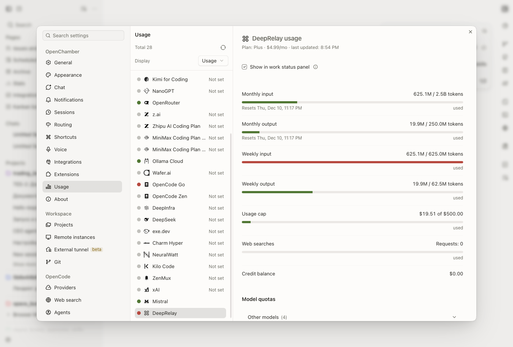
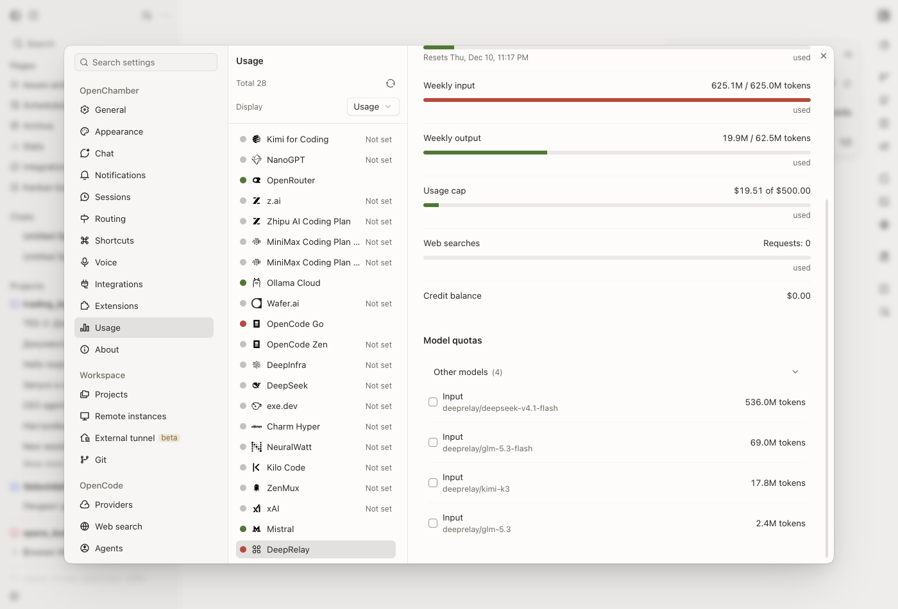

# DeepRelay usage for OpenChamber

Shows your DeepRelay plan, quota and wallet balance on OpenChamber's Usage page, next to the built-in providers.



DeepRelay answers a request with a hard error when a plan meter runs out, and the error names the meter but not the numbers. This extension reads the same numbers the server enforces and puts them where you can see them before the next request fails.

## What the card shows

| Window | Where it comes from |
| --- | --- |
| Monthly input / Monthly output | weighted tokens against the plan's monthly allowance, with the reset date |
| Weekly input / Weekly output | the rolling seven-day caps, which are separate from the monthly ones |
| Usage cap | plan usage at list price against the metered ceiling, in dollars |
| Web searches | server-side searches used against the monthly allowance |
| Credit balance | what is left of the wallet |
| Model quotas | what each model took of the plan this period |

The plan itself is the card's subtitle, for example `Plus · $4.99/mo`. A plan set to cancel at the end of the period says so.



## Install

You need OpenChamber 2.7 or newer, a DeepRelay API key, and that key connected in OpenCode as the `deeprelay` provider. The key needs the `billing:read` scope, otherwise the billing endpoints answer `403`.

```bash
git clone https://github.com/IvanIvanerov/openchamber-deeprelay-usage.git \
  ~/.config/openchamber/extensions/deeprelay-usage
```

Then register the extension:

```bash
./scripts/install.sh
```

Restart OpenChamber and approve the extension under **Settings → Extensions → DeepRelay**. It asks for one capability, `service`, which lets the extension answer the Usage page. The approval covers exactly one thing: reading the credential of the `deeprelay` provider and sending it to `api.deeprelay.ai`.

If you would rather install by hand, add the folder to the `paths` array in `~/.config/openchamber/extensions.json`:

```json
{
  "paths": ["/Users/you/.config/openchamber/extensions/deeprelay-usage"]
}
```

## What it asks for, and what it does with your key

OpenChamber hands the service the credential of the `deeprelay` provider on every call, and nothing else from the credential store. The service sends that key to `https://api.deeprelay.ai/v1/billing/subscription` and `https://api.deeprelay.ai/v1/billing/balance`, and to nowhere else. The key is never written to disk by this extension, and the extension never logs it.

The extension reads two endpoints and writes nothing of its own.

## How it works

OpenChamber's Usage page asks every usage provider for its numbers. Built-in providers do that from inside the app; an extension does it from a small service the app starts on demand.

The service answers one route, `POST /quota`, with the wire OpenChamber's quota role defines. The answer carries usage windows (a share, a label and an optional reset date) and per-model windows. OpenChamber parses it against its own schema and draws the card.

DeepRelay's billing route sits behind a load balancer whose cold backends answer in ten seconds and sometimes in twenty, while OpenChamber waits twenty seconds for the whole call. The first read waits for the answer, two short attempts at a time. Every later read answers from the last good one straight away while a refresh runs behind the call, so a slow upstream costs freshness rather than the card.

## Troubleshooting

**The card is not in the list.** The extension has to be approved. Open **Settings → Extensions**, find DeepRelay and approve the `service` capability; OpenChamber adds the card when the approval lands.

**The card says "Not configured".** OpenCode holds no credential for the `deeprelay` provider. Connect the provider in OpenCode (the key belongs to the provider, not to this extension) and refresh the Usage page.

**The card shows an error about the API key.** The key is rejected or lacks `billing:read`. Mint a key with that scope in the DeepRelay dashboard and connect it again.

**The numbers look stale.** The card shows the last successful read when DeepRelay is slow. The Usage page refreshes every three minutes, and the service refreshes behind that call.

## Development

```bash
npm install
npm test
```

The tests cover the mapping from DeepRelay's numbers to usage windows and the wire contract itself: the answer is parsed with the schema from `@openchamber/sdk`, the same package OpenChamber uses.

```
service/main.js          the HTTP route OpenChamber talks to
service/lib/deeprelay.js the mapping, kept free of transport
test/                    unit tests and the wire contract
scripts/install.sh       registers the extension with OpenChamber
```

## License

MIT. See [LICENSE](LICENSE).
